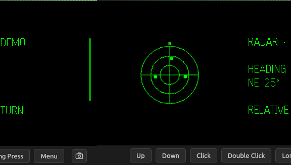
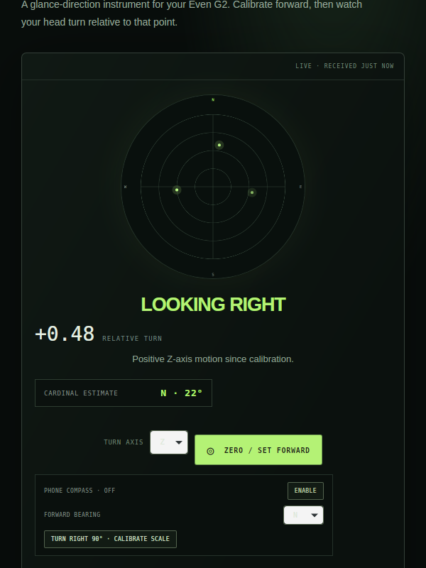

# Even G2 Direction Tracker

A prototype for visualizing G2 head turns from the Even Hub IMU stream. It shows relative turning and an optional cardinal heading estimate, with a pulsing radar whose sample contacts rotate as you turn.

## Run locally

Requires Node.js 20.19+ (or 22.12+) and npm.

From the repository root, run:

```bash
cd even-hub-direction-tracker
npm install
npm run demo
```

`npm run demo` starts the development server and opens the Even Hub tester with generated IMU samples. The dashboard is at [http://localhost:5173/?demo=1](http://localhost:5173/?demo=1). Press **Ctrl+C** in the terminal to stop both. On Linux, install `libwebkit2gtk-4.1-0` to run the tester.

### Virtual glasses display

The tester is showing the app's glasses layout while the dashboard feeds sample head turns into the radar.



### Dashboard



## Try on G2 glasses

Use an Even Hub developer-enabled account and the Even Realities phone app. Start the dev server on a network reachable by the phone, then create and scan a prototype QR code:

```bash
cd even-hub-direction-tracker
npm run dev
# In another terminal, from even-hub-direction-tracker:
npx evenhub qr --url http://YOUR_COMPUTER_LAN_IP:5173
```

In the tracker, inspect the raw X/Y/Z values while turning your head, select the axis that responds to yaw, face forward, and press **Zero / Set Forward**. For cardinal output, provide a forward bearing and calibrate with a known 90° right turn. The G2 IMU alone cannot determine north; the cardinal estimate needs a compass or manual anchor and may drift.

## Project guides

- [Tracker setup and sensor notes](even-hub-direction-tracker/README.md)
- [Code flow, calibration, radar, and future data integration](even-hub-direction-tracker/DEVELOPMENT.md)

Sample radar contacts and `?demo=1` IMU values are for development. The contact feed can later be replaced at the `sampleContacts` source described in the development guide.
